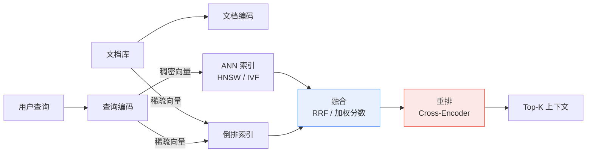
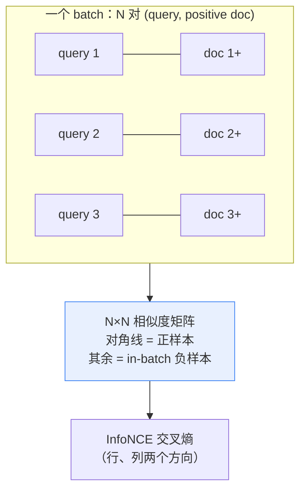
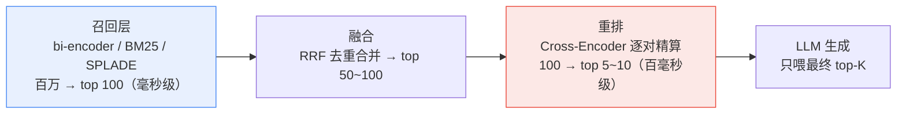

# 检索向量化与混合检索工程笔记

> 面向面试实战：概念 + 工程权衡 + 高频追问。覆盖 **稠密向量 / 稀疏向量 / RRF 与融合 / 索引与工程 / 重排与评测** 五块。
> 同期题库素材：`docs/question-bank-staging/20-retrieval-vectors.json`（来源 `retrieval`，40 道）。

## 0. 一条主线

**把「查询」和「文档」映射到同一个可比空间，再用索引快速找出最近邻；不同映射方式各有盲区，混合检索 + 重排用互补换准确率。**



- **稠密（dense）**：神经网络把语义压进一个固定维度实数向量，懂「同义不同词」，弱在「精确词面、专有名词、数字编号」。
- **稀疏（sparse）**：词表维度上只有少数非零维，每个非零维带权重（BM25 的 TF-IDF 权重，或 SPLADE 学出来的权重），懂「精确命中」，弱在「同义改写」。
- **RRF**：两路召回的**排名**融合，不用对齐分数尺度。
- **重排（rerank）**：查询与文档拼在一起过 Cross-Encoder 精算相关性，用算力换精度，只处理少量候选。

---

## 1. 稠密向量（Dense Embedding）

### 1.1 双塔结构与对比学习

主流文本 embedding 模型是**双编码器（dual-encoder / bi-encoder）**：query 和 document 各过一个（通常共享权重的）Transformer，各自得到一个向量，相似度就是向量运算（cosine / dot）。文档向量可以**离线预计算**，查询时只编码 query——这是它能服务在线检索的根本原因。

训练目标是**对比学习（InfoNCE）**：



- **in-batch negatives**：batch 内其他样本的 doc 天然充当负样本，所以训练 embedding 吃大 batch（batch 越大负样本越难越丰富）。
- **hard negatives（难负例）**：BM25 召回的「看着相关但不是答案」的文档。没有难负例，模型学到的边界太粗，线上表现远低于离线指标。挖难负例是 embedding 模型训练最关键的工程环节之一。
- **温度系数**：InfoNCE 里 logits 除以 τ（常用 0.02~0.05），τ 越小梯度越集中在最难区分的负样本上。
- 高频追问「为什么不用 Cross-Encoder 直接检索？」——Cross-Encoder 把 query+doc 拼一起过模型，精度高但每对都要一次前向，百万文档在线检索不可行；它的位置在**重排**。

### 1.2 相似度度量：cosine 与 dot

- 向量**归一化（L2 norm）后，cosine 与内积数值等价**——大多数 embedding 模型输出已归一化，此时用 dot（很多向量库的 IP 度量）与 cosine 结果一致。
- 不归一化时 dot 会被向量模长污染：长文档向量模长大，dot 偏向「话多」的文档。
- **Euler / L2 距离**与 cosine 单调相关（在归一化向量上），选哪个度量本质不影响排序，但影响索引构建参数与距离阈值语义。

### 1.3 指令前缀（instruction-tuned embedding）

新一代 embedding 模型（E5、BGE、gte、Qwen-Embedding 等）训练时给 query 和 doc 加**不同的任务前缀**，例如 `query: ` / `passage: `，或模型文档指定的 instruction。**用错前缀或漏加是检索质量骤降的常见原因**——它破坏了训练时的分布对称性。面试常问：「换 embedding 模型要改什么？」——维度、度量、前缀约定、切分粒度、**全量重建向量库**。

### 1.4 Matryoshka 表征学习（MRL）

训练时把向量**套娃式截断**（如 1024 维训练目标同时作用在前 256/512/1024 维），推理时可按需截断前缀维度：小维度省存储换速度、大维度保精度。一个模型服务多个「精度-成本」档位，不用训练多个模型。

### 1.5 领域适配

- 通用 embedding 在垂直领域（医疗、法律、代码）会输给词面命中，因为领域同义词与缩写没见过。
- 手段从轻到重：换领域预训练模型 → 对比学习微调（需要领域 query-doc 对，配 hard negatives）→ 退回混合检索让稀疏路兜底。
- 高频追问：「没有标注对怎么微调？」——用 LLM 生成伪 query（doc → 假设性问题），或用弱监督（标题-正文、摘要-正文对）。

### 1.6 多向量与 late interaction（ColBERT）

- 单向量把整段压成一个点，细粒度匹配信息有损。**ColBERT** 为每个 token 保留一个向量（多向量），打分用 **MaxSim**：query 每个 token 向量在文档 token 向量集合里找最大相似度再求和——「late interaction」，交互发生在编码之后。
- 效果好于单向量，但存储（每个 token 一个向量）与检索成本高数个量级，一般用于精排段或小库。

### 1.7 稠密检索的天然盲区

- **精确词面**：产品型号、法条编号、错误码 `E-4021`——语义相近但字面不同会被检索到，字面完全一致的反而可能排不上去。
- **OOV / 新术语**：训练语料之后出现的词、内部代号。
- **长文档信息稀释**：一个向量代表整段，多主题文档各主题互相稀释 → 解法在切分（chunking）而非换模型。
- 这是**混合检索存在的根本理由**，也是面试里「什么时候纯向量检索不够」的标准答案。

---

## 2. 稀疏向量（Sparse Vector）

### 2.1 BM25：词面检索的工业基线

BM25 对 query 中每个词项打分后求和，核心三件套：

| 组件 | 公式意图 | 参数 |
|---|---|---|
| 词频饱和 | TF 贡献随词频增长**递减收敛**，不是线性 | k1（常用 1.2~2.0），控制饱和速度 |
| 文档长度归一 | 长文档天然词多，按平均文档长度惩罚/归一 | b（常用 0.75），b=0 关闭归一 |
| IDF | 稀有词信息量大，常见词（的、是）贡献趋近 0 | 无参数，来自语料统计 |

面试高频：「BM25 的 TF 为什么做饱和？」——防止一个词重复出现 100 次的文档无限刷分；相关性增长有收益递减。「b 调大调小分别是什么效果？」——b 越大对长文档惩罚越重；短 query 场景 b 大通常更好。

### 2.2 倒排索引

稀疏检索的数据结构是**倒排索引（inverted index）**：词项 → 含该词的文档列表（带权重与位置）。查询按词项取 posting list 合并。与 ANN 索引（向量 → 近邻）方向相反。术语：posting list、term frequency、position index（短语查询需要）。

### 2.3 学习型稀疏：SPLADE

**SPLADE** 用 MLM 头在词表维度上输出稀疏激活权重，把「选哪些词、每个词多重要」交给模型学：

- **文档侧扩展**：模型会给文档「补」上语义相关但未出现的词（隐式 query/doc expansion），权重 learned 而非 TF-IDF。
- **查询侧扩展**：同样能扩展查询词，缓解词面不匹配。
- 表示仍是稀疏向量（词表维度 + 非零权重），**可以直接进倒排索引或支持稀疏向量的引擎**（Elasticsearch/OpenSearch 的 learned sparse、Qdrant/Milvus 的 sparse vector）。
- 对比 BM25：SPLADE 精度普遍更高、能处理同义改写；代价是要跑模型（文档侧离线、查询侧在线多一次推理）、可解释性下降。
- 高频追问：「SPLADE 和稠密检索什么关系？」——都是神经检索，但 SPLADE 的匹配发生在**词项空间**（可解释、可精确命中、对 OOV 相对稳），稠密匹配发生在**隐空间**。两者是并列的神经检索路，不是替代 BM25 的唯一方式。

### 2.4 稀疏向量的存储形态

向量数据库里的稀疏向量通常表示为 `(indices, values)`：非零维下标 + 权重。与稠密向量不同，维度是**词表大小**（几万到几十万），但非零元通常几十到几百个——存储与计算都按非零元走，这是「稀疏」的工程含义。

### 2.5 什么时候稀疏路赢

- 查询含精确标识符、型号、代码、人名产品名；
- 语料专业术语密集、同义改写少；
- 完全没有 GPU / 不能跑推理模型的部署环境（BM25 零模型依赖）；
- 冷启动：新文档刚入库、embedding 尚未算完，倒排索引立即可查。

---

## 3. RRF 与融合策略

### 3.1 RRF 公式与直觉

**Reciprocal Rank Fusion**：对每个候选文档，取它在各路召回里的排名 r，按下面公式累加：

```
RRF(d) = Σ_channels  1 / (k + rank_channel(d))     # k 经验值 60
```

- **为什么用排名不用分数**：BM25 分数（0~几十，无上界）与向量 cosine（归一化后 0~1）**尺度不可比**，直接加权求和必有一路主导。排名是尺度无关的。
- **k=60 的作用**：压平头部排名差距。k 越大，第 1 名与第 5 名的分差越小，融合越「民主」；k 越小越偏向各路头部。k 是平滑常数而非魔法数，一般不需要调。
- **对数算清楚（k=60）**：文档 A 在两路分别排第 1、第 4 → 贡献 1/61 + 1/64 ≈ 0.03202；文档 B 两路都排第 2 → 1/62 + 1/62 ≈ 0.03226。**「两路都靠前」击败「一路第一一路靠后」**——这正是混合检索要的稳健性。（顺带一提，「第 1 + 第 3」与「两个第 2」几乎打平且前者略高，可见 RRF 对头部差距非常钝——这本身就是 k 平滑的设计意图。）

### 3.2 Rank fusion vs Score fusion

| 维度 | RRF（rank fusion） | 加权分数融合（score fusion） |
|---|---|---|
| 前提 | 只要排名 | 各路分数需可对齐（min-max / z-score 归一） |
| 调参 | 几乎免调（k 固定） | 每路一个权重，需数据驱动调参 |
| 表达力 | 只用序信息，丢失「第一名甩开多少」 | 能表达分数差距，调好了上限更高 |
| 典型场景 | 快速上线、通道数多 | 有评测集、愿意持续调参的成熟系统 |

高频追问：「RRF 丢失了什么信息？」——分数的绝对差。两路第一名如果分数断崖领先，RRF 与第三名一视同仁。所以精调系统常用 **加权 RRF**（每路乘权重）或分数融合。

### 3.3 融合的工程细节

- **ID 对齐**：两路召回必须用同一文档 ID 空间（chunk id），去重后再融合；「同一段被切成两个 chunk 两路各召回一半」要在融合前去重或按父文档合并。
- **各路召回深度**：RRF 前每路取 top-N（常用 50~100），N 太小融合后尾部抖动大。
- **融合位置**：召回层融合（先融合再重排，重排器只看一次候选）是主流；「每路各重排再融合」成本翻倍，只在多业务方时用。
- **退化行为**：某路超时/失败时，RRF 自然退化为单路排名——这是它比分数融合更稳的工程优点。

---

## 4. 索引与工程

### 4.1 HNSW

分层可导航小世界图：上层稀疏长边快速导航，底层稠密短边精确搜索。

| 参数 | 作用 | 调大 | 调小 |
|---|---|---|---|
| M | 每个节点出边数 | 召回↑ 内存↑ | 省内存召回降 |
| ef_construction | 建图时候选队列 | 建图慢图质量高 | 建图快图质量差 |
| ef_search | 查询时候选队列 | 延迟↑ 召回↑ | 延迟低召回降 |

高频追问：「HNSW 为什么是近似（ANN）不是精确？」——贪心导航可能错过真近邻，ef_search 限制每层展开规模；要精确可暴力扫（小库反而更快）。内存账：每个向量除了原向量（如 1024 维 float32 = 4KB）还要 M×2 个邻居 id，M=16 时约 128 字节/节点——**图结构开销通常远小于向量本身**，真正的大头是原始向量。

### 4.2 IVF 与量化压缩

- **IVF**：先聚类成 nlist 个簇，查询只扫 nprobe 个最近簇。nprobe 占比决定召回-延迟曲线。
- **PQ（乘积量化）**：向量切段、每段聚类用码本 id 压缩，1024 维 float32 4KB → 几十字节，代价是召回损失。**OPQ** 先旋转再量化减少损失。
- 内存紧张的标准组合：**HNSW + PQ**，或先量化存储、top 候选再取原向量精算（refine/rerank by exact distance）。

### 4.3 元数据过滤：pre-filter vs post-filter

- **post-filter**：先 ANN 取 top-K 再按条件过滤——条件命中少时返回不足 K 条甚至 0 条。
- **pre-filter**：先按条件筛出候选集再 ANN——引擎需要支持「过滤后的图搜索」（遍历时跳过不合格节点），否则性能塌方。
- 高频追问：「带权限过滤的向量检索要注意什么？」——必须 pre-filter（权限过滤后候选集小，post-filter 会空洞），且要确认引擎的 filtered HNSW 实现（如 Qdrant 的 filterable index）。

### 4.4 工程流水线问题

- **重建成本**：换 embedding 模型 = 全库重编码 + 重建索引；大库要双写过渡（新旧索引并存灰度切流）。
- **增量更新**：HNSW 支持插入但频繁删除会产生图上「僵尸边」，定期重建；IVF 增量插入会打破簇均衡。
- **多租户/集合隔离**：按租户分 collection 还是向量加租户字段 pre-filter——前者隔离彻底、索引碎片化；后者索引共享、每次查询都带过滤。

---

## 5. 重排（Rerank）与评测

### 5.1 两阶段架构



- **bi-encoder**：query 与 doc 分别编码，可预计算，精度受限（无交互）。
- **cross-encoder**：`[CLS] query [SEP] doc` 一起过模型，注意力在词级交互，精度显著更高，但每对一次前向——只能处理小候选集。
- 重排模型：bge-reranker、Qwen-Rerank 等，或 LLM pointwise/listwise 打分。
- **召回深度与重排窗口要配套**：重排只能救回「已在候选里」的文档——若相关文档根本没进 top-100，重排再强也无济于事（「重排的天花板是召回」）。

### 5.2 评测

- **检索组件级**：golden set（query → 相关文档 id 集合），指标 **recall@k**（相关文档是否进 top-k）、**MRR**（第一个相关结果的排名倒数）、**nDCG@k**（考虑分级相关性与位置折扣）。
- **端到端**：RAG 最终答案质量（faithfulness、answer relevance），检索组件优化不必然传导到端到端——上线前用净收益验证（参考本项目 r142 实践：`acpeng-015` 同款考点）。
- **评测集构建**：真实查询日志 + 人工标注 > LLM 生成伪 query（有分布偏差）；分层抽样覆盖短 query、长 query、精确词 query。
- **调优顺序经验法则**：先修 chunking（粒度/重叠/结构保留）→ 换或微调 embedding → 加混合检索 → 上重排 → 调 k 与深度参数。顺序反了会在错误的文本单元上调融合参数，白费功夫。

### 5.3 本项目对照

本项目 RAG（r120 起）：embedding 用阿里云百炼 `qwen3.7-text-embedding-flash`（1024 维），rerank 用 `qwen3.7-text-rerank`（dashscope 协议）；embedding/rerank 都是**云端 API 调用**，本地容器已停用但可 `--profile embed|rerank` 一键切回。内网口径下 embedding 走离线哈希、rerank 关闭——正好对应「神经检索组件是可选增强、稀疏路是保底」的分层设计。面试里被问「你们的检索架构」时，可以按「召回路 → 融合 → 重排 → 内网降级」四层讲。

---

## 6. 快问快答（15 条）

1. **Q：cosine 和 dot 什么时候等价？** A：向量都做了 L2 归一化时数值等价；主流 embedding 输出已归一化，所以常等价。
2. **Q：为什么 embedding 训练吃大 batch？** A：in-batch negatives 数量随 batch 线性增长，负样本越多越难，对比学习信号越强。
3. **Q：hard negative 是什么，为什么重要？** A：BM25 挖来的「表面相关实则不相关」文档；不挖难负例模型边界太粗，线上远差于离线。
4. **Q：换 embedding 模型的代价清单？** A：维度、度量、指令前缀、全库重编码重建索引、评测基线重跑。
5. **Q：Matryoshka 解决什么？** A：一个模型多个截断维度，按精度-成本档位选维度，不用训多个模型。
6. **Q：BM25 的 k1 和 b 分别控制什么？** A：k1 控词频饱和速度，b 控文档长度归一强度。
7. **Q：SPLADE 相比 BM25 的本质区别？** A：BM25 权重是统计公式，SPLADE 权重是模型学出来的且带隐式词扩展。
8. **Q：稀疏向量的工程表示？** A：词表维度上 (indices, values) 非零对，按非零元存储计算。
9. **Q：RRF 为什么用排名不用分数？** A：各路分数尺度不可比，排名天然尺度无关。
10. **Q：RRF 的 k=60 是干什么的？** A：平滑常数，压平头部排名差距；k 越大融合越平均。
11. **Q：HNSW 三个关键参数？** A：M（出边数）、ef_construction（建图质量）、ef_search（查询召回-延迟旋钮）。
12. **Q：post-filter 的坑？** A：过滤后候选不足 K 条，结果空洞；权限过滤必须 pre-filter。
13. **Q：为什么重排不能提升召回天花板？** A：相关文档没进候选集，重排器永远见不到它。
14. **Q：recall@k 与 nDCG 的区别？** A：recall 只看相关文档进没进 top-k，nDCG 还看排名位置与相关性分级。
15. **Q：RAG 检索调优的正确顺序？** A：chunking → embedding → 混合 → 重排 → 参数，先修文本单元再调融合。

---

## 7. 自检清单

- [ ] 能画出「双路召回 → RRF → 重排 → top-K」架构图并说清每层延迟量级
- [ ] 能推导 RRF 公式并用一个双文档例子说明「两路都靠前 > 一路第一」
- [ ] 能说清 BM25 三组件的公式意图与 k1/b 的调节效果
- [ ] 能解释 SPLADE 的文档/查询扩展机制与稀疏向量表示
- [ ] 能算一笔 HNSW + 1024 维 float32 的内存账（向量本体 vs 图结构）
- [ ] 能说清 pre-filter / post-filter 的空洞问题与权限过滤的正确姿势
- [ ] 能列检索评测三指标（recall@k / MRR / nDCG）与 golden set 构建要点
- [ ] 能背出调优顺序：chunking → embedding → 混合 → 重排 → 参数
